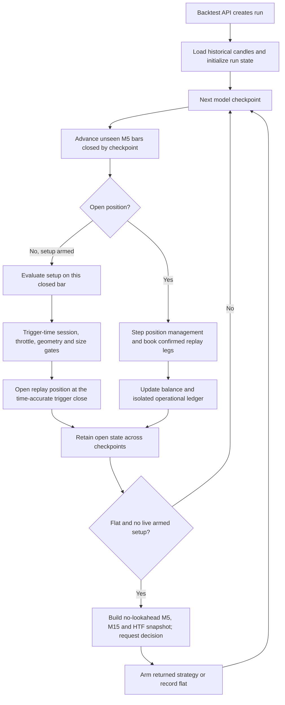

# Backtest lifecycle and verification

The runner has two clocks: model checkpoints and closed M5 bars. A checkpoint may
request a new idea; it cannot jump through future bars to finish a trade. Armed
setups and open positions persist across checkpoints.

## Data and control boundaries

| Concern | Current implementation / implication |
|---|---|
| Entry point | [Backtest router](../../apps/backend/routers/backtest.py): `/backtest/run` starts a background run with stored status and iterations. Model-driven runs can incur API spend. |
| Candle availability | [ClosedBarFeed](../../packages/core/backtest_bar_feed.py) selects bars closed by explicit time; M5 open time plus 5 minutes is availability. Runner slices M15 by its 15-minute duration and drops incomplete HTF bars. |
| Chronology | [BacktestRunner](../../packages/core/backtest_runner.py) advances unseen closed bars, retains armed state, prevents overlapping positions within its run and applies exits before later opportunities. It no longer scans an arming TTL into future checkpoints. |
| Trigger | Evaluate historical context separately from current closed bar; entry time is trigger close. The trigger bar's earlier wick cannot stop a position entered only at its close. |
| Entry gates | Shared geometry/stop/lot logic, trigger-time event/session horizon, throttle and account sizing. Impossible sided stops are rejected before widening; TP1 is preserved when TP2 is capped. |
| Position path | [PositionSimulator](../../packages/core/backtest_account.py), [position monitor](../../packages/core/backtest_position_monitor.py), [shared rules](../../packages/core/trade_monitor.py): native stop priority, adverse gap handling, partial legs, TP2 runner and elapsed-time expiry/extension. Ambiguous OHLC stop/target paths use conservative stop ordering. |
| Outcome | Contract-size P&L and volume-dependent modeled commission, with realized legs tracked before final closure. Initial risk uses original stop and filled size. |
| Operational history | Per-run isolated in-memory ledger imports only replay legs already booked, supplies recent whole-position views and time-based cooldown. Future exits remain isolated from earlier decision context. |
| Scope | A `BacktestRunner` is asset-scoped. Separate asset runs are not a shared portfolio/account replay; aggregate capacity, scheduling and cross-asset risk need a dedicated comparison. |
| Quote mode | `PositionSimulator.step_quote` accepts executable quote samples. Standard backtests use completed M5 OHLC bars. |

## Reproducibility record

Save run ID, source/config manifest including uncommitted files, input file hashes
and actual coverage, timezone and candle duration, asset/contract specs, initial
balance, cost assumptions, checkpoint cadence, model/prompt/schema/compiler versions,
mode and opportunity IDs. Preserve checkpoints, skipped/armed/filled opportunities,
leg ledger, final positions and incomplete end-of-window positions. Explicitly report
coverage of holding periods and post-exit diagnostics at the end of the dataset.

Replay stored decisions for deterministic comparisons before paying for new model
outputs. Compare entry selection on chronological opportunity streams, including
newly freed windows; compare exit policies on identical accepted entries first, then
rerun lifecycle interactions. Keep the source version fixed within a comparison.

## Engineering verification

Use the configured AI provider and historical CSVs to exercise the replay lifecycle. Record the candle window, configuration, and decision outputs. Fresh AI decisions can vary; use saved decisions when isolating an engine change.
