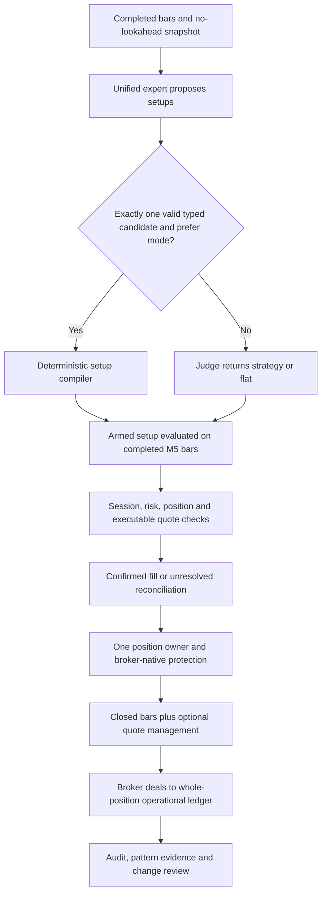

# TradeLense quick flow

> **Status:** living · verified against working-tree source 2026-09-21

The configured decision path uses one unified expert (`EXPERT_KINDS = ["trend"]`)
and a judge. The name `multi_expert` is retained in code; it does not mean three
experts currently run. Models are configurable; this guide does not assume a
particular provider or model version.

`TYPED_SETUP_MODE=shadow` is the default: it records an eligible compiled candidate
alongside ordinary adjudication. Judge bypass requires explicit `prefer` mode.
`FAST_POSITION_MODE=shadow` samples prospective quote actions, approximately every
2 seconds; it does not execute the new quote-target policy. Structural trail and
TTL confirmation remain tied to completed bars. `live` enables quote target actions.

Backtests advance completed bars chronologically between model checkpoints. Armed
setups and open positions preserve state across checkpoints, while executable
quote inputs remain a dedicated live boundary.

Continue with the [full architecture](system-architecture.md), the verified
[backtest flow](backtest-flow.md), and the
[historical candle setup](../../data/processed/README.md).
