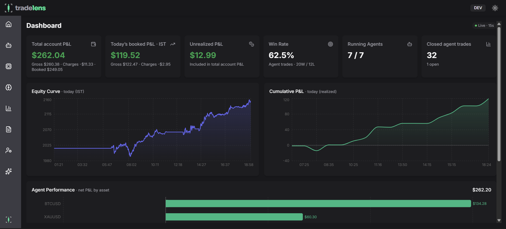
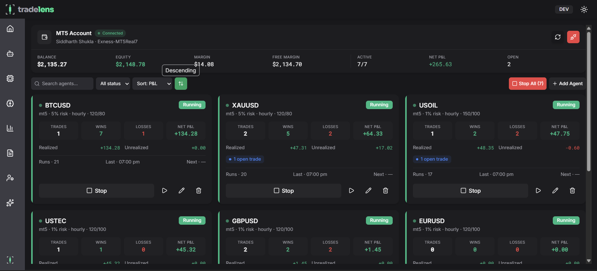
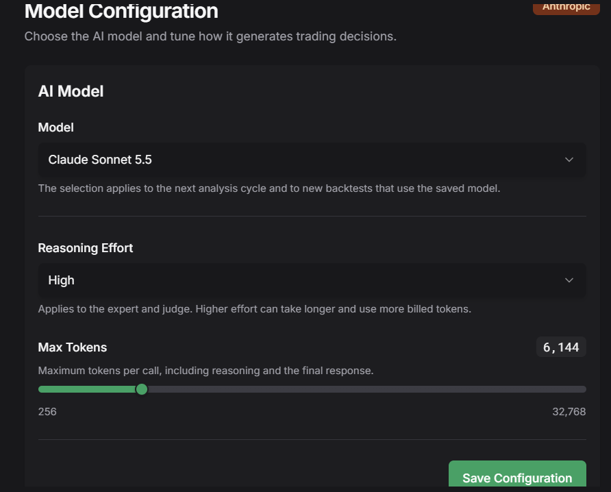
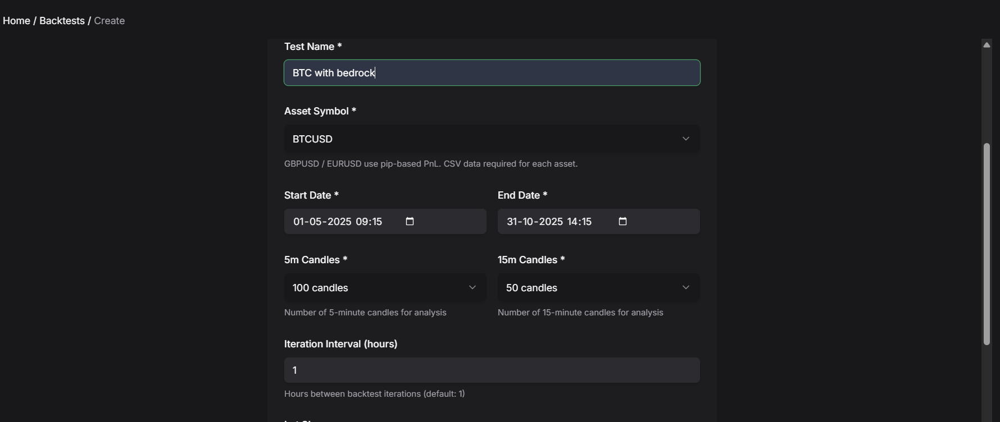
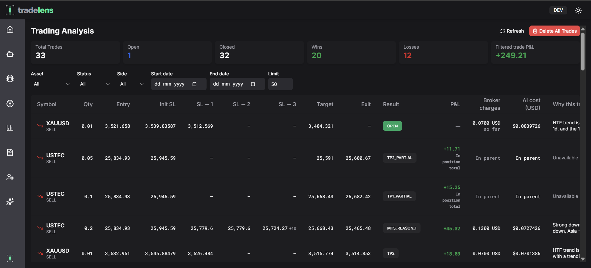
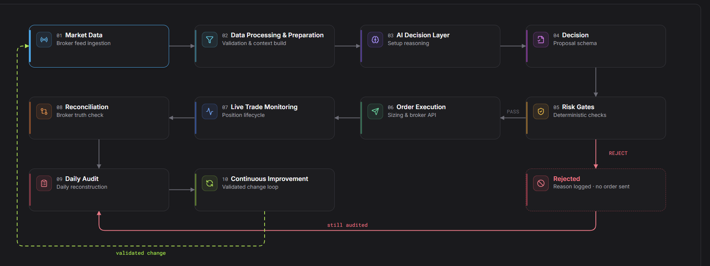

# TradeLense screenshots

These captures show the development interface. The P&L and trade figures reflect the account at the time of capture.

## Dashboard

## MT5 agents

## Model configuration

## Backtest setup

## Trading analysis

## Trading workflow

